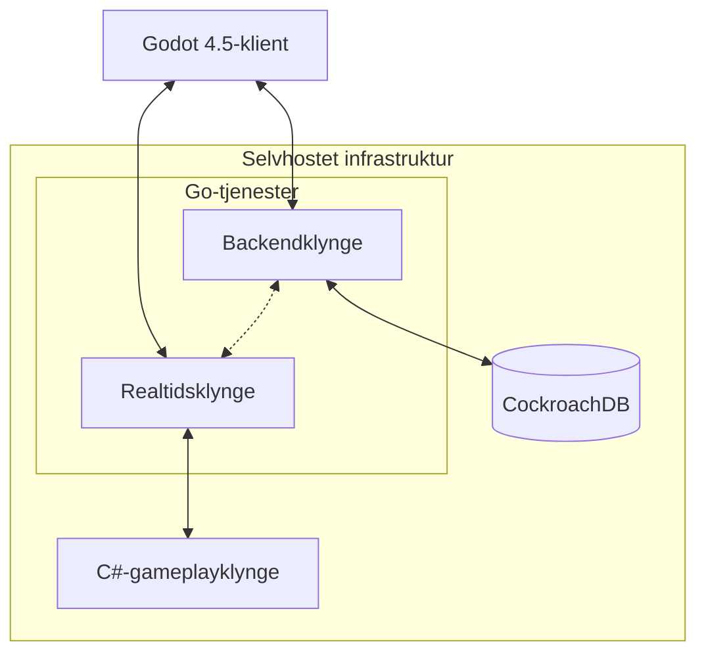

> [!NOTE]
> **Bemærk:** CybarTera er primært en teknisk demonstration af mine backend-kompetencer og en personlig platform til at eksperimentere med distribuerede systemer. Det er ikke et færdigt spil.

# 🌌 CybarTera
### The Fractured World of CybarTera

**Et selvstændigt udviklet 3D-MMORPG og et eksperiment med distribueret backendarkitektur.**

Bygget med **Godot 4.5, Go, C# og CockroachDB**.

[🇬🇧 Read in English](./README.md)

---

## 📖 Om projektet

**CybarTera** er et selvstændigt udviklet 3D-MMORPG og, endnu vigtigere, et længerevarende eksperiment med distribuerede systemer, realtidsnetværk og backendudvikling.

Det, der begyndte som et mindre porteføljeprojekt, udviklede sig til en langt større teknisk udfordring: at designe en multiplayer-infrastruktur med en vedvarende spilverden, distribuerede gameplay-tjenester og potentiale for tusindvis af samtidige interaktioner.

CybarTera er inspireret af det sociale samspil i Habbo Hotel, omfanget af World of Warcraft og cyberpunk-æstetik. Projektet kombinerer klassiske MMORPG-mekanikker med en specialudviklet serverarkitektur.

Hele projektet udvikles af én person: fra backendinfrastruktur, netværk og databasedesign til gameplay, klientudvikling og serverdrift.

**Det primære mål er ikke at udgive et kommercielt MMORPG, men at undersøge de tekniske udfordringer ved at bygge et.**

### Projektet i korte træk

| Område | Teknologi / tilgang |
|---|---|
| Spilmotor | Specialkompileret Godot 4.5 |
| Backend-tjenester | Go |
| Realtidstjenester | Go |
| Gameplay-simulering | C# |
| Database | CockroachDB |
| Infrastruktur | Selvhostet VPS |
| Arkitektur | Distribueret, flere serverklynger |
| Målplatforme | Linux, Windows, Android |
| Udvikling | Selvstændig / solo |
| Status | Pre-alpha |

---

## 🎮 Et indblik i CybarTera

.png)

*Et tidligt indblik i CybarTera under udviklingen.*

Selvom spillet stadig er i pre-alpha, omfatter CybarTera allerede en række sammenhængende systemer: fra multiplayer-synkronisering og vedvarende spillerprogression til kamp, kunstig intelligens og sociale funktioner.

Samspillet mellem disse systemer gør projektet velegnet til at eksperimentere med backendarkitektur, netværkskommunikation og serversimulering.

---

## ⚙️ Tekniske højdepunkter

CybarTera er bygget som en teknisk udfordring frem for udelukkende at benytte spilmotorens standardløsninger til netværk.

Arkitekturen opdeler applikationstjenester, realtidskommunikation og gameplay-simulering i specialiserede komponenter.

### Distribueret backendarkitektur

Backendinfrastrukturen består af flere tjenester skrevet i Go og C#.

**Go-backendklynge**

Håndterer generelle backendfunktioner og applikationstjenester, som understøtter multiplayer-miljøet.

**Go-realtidsklynge**

Er dedikeret til netværkskommunikation i realtid og multiplayer-synkronisering.

**C#-gameplayklynge**

Håndterer gameplayrelaterede beregninger og processer, herunder:

- NPC- og fjendeadfærd
- Kunstig intelligens
- Kampberegninger
- Simulering af spilverdenen
- Håndtering af gameplaytilstand

Opdelingen gør det muligt at undersøge, hvordan forskellige arbejdsbelastninger kan fordeles mellem selvstændige tjenester i stedet for at blive håndteret af én monolitisk spilserver.

### Vedvarende data

CockroachDB anvendes til at understøtte vedvarende data om spillere og spilverdenen.

Projektet undersøger håndtering af vedvarende tilstand for blandt andet:

- Spillerprogression og karakterstatistik
- Inventar og udstyr
- Ressourcer i spilverdenen
- Boliger og spillerejede områder
- Sociale systemer og guilds

### Netværk og skalering

Infrastrukturen omfatter følgende koncepter og mekanismer:

- Multiplayer-synkronisering
- Kommunikation mellem distribuerede tjenester
- Belastningsfordeling
- Serverklynger
- Opdeling af spilverdenen
- Regional sharding
- Dynamisk skalering
- Vedvarende tilstand

Disse udfordringer er centrale for projektets formål: at forstå, hvordan realtidsbaserede multiplayer-systemer kan struktureres, når en virtuel verden bliver stadig mere kompleks.

---

## 🏗️ Systemarkitektur

Grundarkitekturen består af en Godot-klient, som kommunikerer med specialiserede serverklynger.

*Overordnet, konceptuelt arkitekturdiagram. Tjenesteopdelingen er baseret på projektets dokumentation; de præcise kommunikationsveje og protokoller bør verificeres mod implementeringen.*

### Arkitekturens designmål

**Ansvarsopdeling**

Applikationslogik, realtidsnetværk og gameplay-simulering holdes adskilt for at reducere kobling og give mulighed for selvstændig videreudvikling.

**Skalerbarhed**

Arkitekturen undersøger, hvordan arbejdsbelastningen kan fordeles på flere serverinstanser og regionsspecifikke processer.

**Vedvarende data**

Spiller- og verdensdata opbevares uafhængigt af de enkelte spilsessioner.

**Serversidebehandling**

Gameplaylogik og validering er designet omkring serversystemer, så klienten ikke alene bestemmer den vedvarende tilstand.

**Vedligeholdelse**

Specialiserede komponenter gør det muligt at arbejde med enkelte tjenester uden at skulle redesigne hele applikationen.

---

## 🌍 Verdensopdeling og regional skalering

En af CybarTeras større tekniske udfordringer er at håndtere en vedvarende spilverden på tværs af regioner.

Verdenen er hierarkisk opdelt for at understøtte regional behandling og skalerbar simulering.

### Verdensdimensioner

| Komponent | Dimensioner |
|---|---|
| Samlet verden | 65.536 × 65.536 meter |
| Superregion | 2.048 × 2.048 meter |
| Underregion | 128 × 128 meter |
| Underregioner pr. superregion | 256 |
| Superregioner i alt | 1.024 |

Hver superregion indeholder et gitter på 16 × 16 underregioner.

Denne struktur danner grundlag for eksperimenter med opdeling af spilverdenen, rumlig organisering og fordeling af simulationsarbejde mellem servere.

### Arkitektoniske overvejelser

Den regionale arkitektur er tænkt til at håndtere udfordringer som:

- Sporing af spillere på tværs af store områder
- Håndtering af regionsspecifik simulationsbelastning
- Fordeling af gameplayberegninger
- Overgange mellem regioner
- Synkronisering af vedvarende tilstand
- Skalering af serverressourcer efter aktivitet

Systemet giver mulighed for at arbejde med nogle af de samme arkitekturproblemer, der findes i større multiplayer-applikationer.

---

## 🎯 Gameplay og implementerede systemer

Selvom backendudvikling er projektets primære fokus, omfatter CybarTera også en omfattende samling af gameplay-systemer.

### ⚔️ Kamp og karakterudvikling

- Karakterstatistik og egenskaber
- Styrke, smidighed, intelligens og modstandsevner
- Angreb, evner og helbredssystemer
- Måludvælgelse og visning af skade
- Død og genoplivning
- Niveauer og karakterprogression
- Fjendemøder og kampinteraktioner

### 🧠 Kunstig intelligens

- NPC- og fjendeadfærd
- Stifinding
- Patruljesystemer
- Aggro-håndtering
- Kamptaktik
- Gameplay-simulering på serveren

### 🎒 Inventar og økonomi

- Inventarstyring
- Udstyrssystemer
- Handel mellem spillere
- Guld og credits
- Indsamling af ressourcer
- Forskellige grader af sjældenhed for loot
- Vedvarende ressourcer

### 💬 Multiplayer og sociale systemer

- Kontoregistrering og login
- Multiplayer-synkronisering
- Global chat
- Gruppebeskeder og private beskeder
- Vennelister og blokering
- Guild- og klanstyring
- Guild-chat og delt opbevaring

### 🏠 Boliger og vedvarende miljøer

- Spillerlejligheder
- Fri placering og gitterbaseret møblering
- Vedvarende dekorationer
- Boligopgraderinger
- Spillerejede områder

### 🗺️ Missioner og udforskning

- Hoved- og sidemissioner
- Udforskning af en åben verden
- Hurtigrejse
- Køretøjer
- Grundstruktur til dungeons og raids
- Matchmaking til instanser

### 🖥️ Brugergrænseflade

- Specialudviklede brugergrænseflader
- Lyd- og grafikindstillinger
- Tilpasning af tastaturgenveje
- Simuleret operativsystem inde i spillet
- Virtuelle brugergrænseflader til telefon, desktop og laptop

Projektet omfatter desuden et lokaliseringssystem med understøttelse af 28 sprog, som i øjeblikket er deaktiveret under udviklingen.

---

## 🔐 Sikkerhed og dataintegritet

Sikkerhed er en del af overvejelserne bag projektets backendarkitektur.

De dokumenterede systemer omfatter:

- Datavalidering på serveren
- Anti-cheat-mekanismer
- Kontorelaterede funktioner
- Vedvarende sikkerhedskopier
- Adskillelse af klientens og serverens ansvar

Et vigtigt fokusområde er at begrænse klientens mulighed for selv at bestemme gameplay- og verdensdata.

Det giver mulighed for at udforske sammenhængen mellem backendudvikling, netværk og applikationssikkerhed.

---

## 📸 Screenshots og udviklingsbilleder

Disse billeder dokumenterer forskellige faser og dele af CybarTeras udvikling.

| | | |
|:---:|:---:|:---:|
| .png) | .png) | .png) |
| .png) | .png) | .png) |
| .png) | .png) | .png) |
| .png) | .png) | .png) |
| .png) | .png) | .png) |
| .png) | .png) | |

*Billederne er fra udviklingsversioner og viser ikke nødvendigvis et færdigt produkt.*

---

## 🛠️ Projektets udviklingshistorie

CybarTera begyndte som et personligt udviklingsprojekt i en tidligere generation af AI-assisterede udviklingsværktøjer.

En stor del af den grundlæggende arkitektur blev designet og udviklet selvstændigt, før moderne AI-kodeassistenter blev i stand til at generere og analysere større softwaresystemer på det niveau, de kan i dag.

Projektet krævede research, eksperimenter, fejlfinding og praktisk problemløsning på tværs af flere tekniske områder.

Særligt fokus har været på:

- Design af grænser mellem distribuerede tjenester
- Realtidssynkronisering over netværk
- Håndtering af vedvarende tilstand
- Udvikling af backendtjenester i Go
- Udvikling af gameplaytjenester i C#
- Integration mellem Godot og egen backendinfrastruktur
- Serverskalering og regional simulering

Projektet afspejler en interesse for at forstå teknologien i dybden frem for kun at anvende færdige frameworks og løsninger.

### Hvorfor bygge et MMO?

MMORPG'er samler en lang række udfordrende softwareproblemer i ét miljø.

Netværk, databaser, samtidighed, simulering, datalagring, sikkerhed og infrastruktur skal fungere sammen.

Derfor blev CybarTera en praktisk måde at undersøge komplekst systemdesign på og samtidig bygge noget kreativt.

---

## 🚧 Udviklingsstatus

**Nuværende status: Pre-alpha / teknisk demonstration**

CybarTera vedligeholdes primært som et personligt udviklings- og porteføljeprojekt frem for et kommercielt udgivet spil.

Dokumentationen omfatter implementerede gameplay-systemer, arkitektureksperimenter og funktioner, der endnu er under udvikling.

### Under udvikling

- Udvidet visuel kampfeedback og effekter
- Talenttræer
- Auktionsfunktioner
- Understøttelse af flere platforme

### Planlagte og eksperimentelle funktioner

- PvP-arenaer og PvP i den åbne verden
- Mere avancerede systemer til crafting og indsamling
- Dynamisk vejr og miljøsystemer
- Udvidede dungeon- og raid-mekanikker
- Yderligere AI-koordination
- Mere omfattende servertelemetri
- Værktøjer til ydeevne- og belastningstest
- Yderligere sikkerhedsovervågning
- Værktøjer til gameplaybalancering og administration

Disse funktioner er mulige udviklingsretninger, ikke løfter om en kommerciel udgivelse.

---

## 🧩 Tekniske udfordringer og erfaringer

CybarTera har givet praktisk erfaring med flere tæt forbundne tekniske problemstillinger.

**Distribuerede systemer**

At forstå, hvordan uafhængige tjenester kan samarbejde og samtidig bevare en sammenhængende applikationstilstand.

**Realtidsnetværk**

At eksperimentere med synkronisering, responstid og serversidebehandling.

**Databasearkitektur**

At designe vedvarende datastrukturer til indbyrdes afhængige systemer og langsigtet spillerprogression.

**Infrastruktur**

At arbejde med selvhostede tjenester, deployment, serverressourcer og distribuerede arbejdsbelastninger.

**Softwarearkitektur**

At forstå, hvordan tidlige designbeslutninger påvirker skalerbarhed, vedligeholdelse og kompleksitet.

**Sikkerhed**

At tage højde for validering, tillidsgrænser og risici ved netværksforbundne klientapplikationer.

---

## 👨‍💻 Om udvikleren

CybarTera udvikles selvstændigt af **Razorsixfive**, en softwareudvikler med baggrund inden for backendprogrammering, cloud-teknologier og cybersikkerhed.

Projektet samler flere tekniske interesseområder:

- Udvikling i Go og C#
- Distribuerede systemer
- Multiplayer-netværk
- Databasearkitektur
- Infrastrukturudvikling
- Applikationssikkerhed
- Spiludvikling

CybarTera er både et kreativt projekt og en praktisk demonstration af selvstændig teknisk udforskning.

---

## 📄 Licens og ansvarsfraskrivelse

Dette repository er et personligt porteføljeprojekt og en teknisk demonstration.

CybarTera er ikke et færdigt kommercielt MMORPG, og flere funktioner er fortsat eksperimentelle eller ufærdige.

**Licens:** Proprietær. Se [LICENSE](./LICENSE).

---

## 🔗 Links

- [GitHub-profil](https://github.com/Razorsixfive)
- [TryHackMe-profil](https://tryhackme.com/p/razorsixfive)
- [Godot Engine](https://godotengine.org)

**Bygget selvstændigt. Drevet af lysten til at eksperimentere, lære og forstå komplekse softwaresystemer.**

- [Diskussioner](https://github.com/USERNAME/REPO/discussions)
- [Godot Engine](https://godotengine.org)
