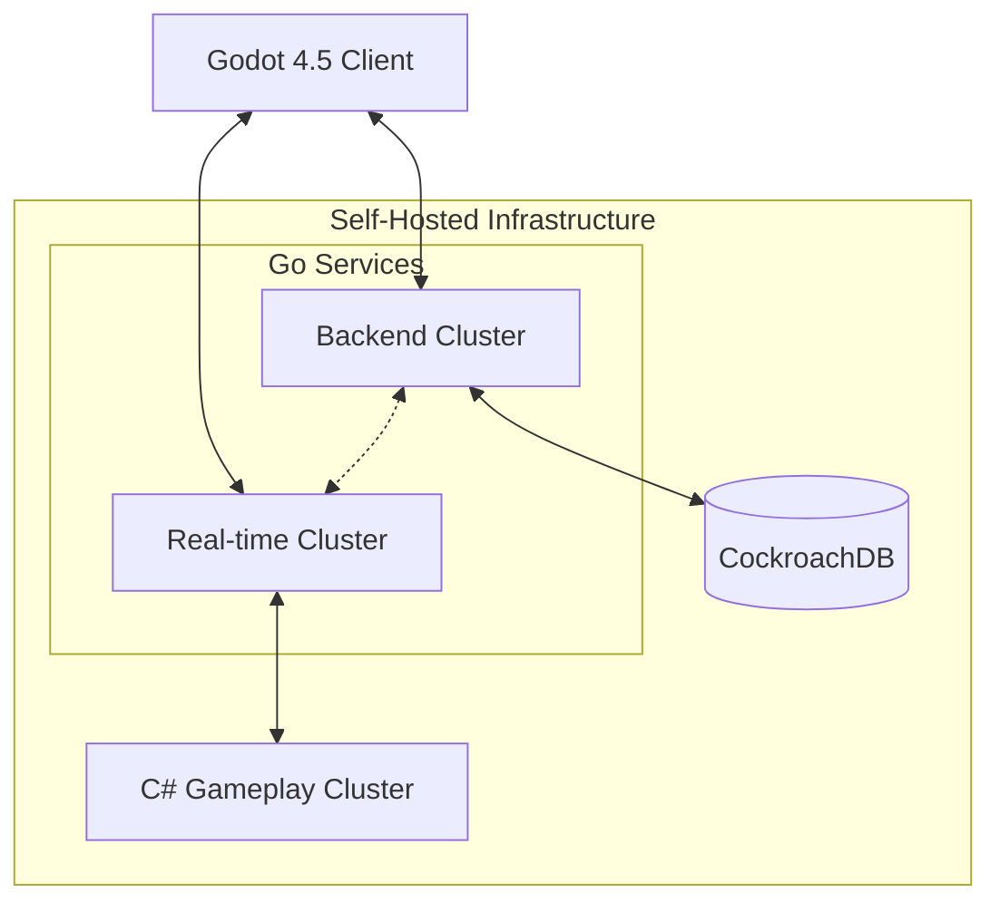

> [!NOTE]
> **Disclaimer:** This project is primarily a technical demonstration of my backend capabilities. It serves as a portfolio piece and a personal sandbox for experimentation, rather than a fully-featured game.

# 🌌 CybarTera
### The Fractured World of CybarTera

**A solo-developed 3D MMORPG and distributed backend architecture experiment.**

Built with **Godot 4.5, Go, C#, and CockroachDB**.

[🇩🇰 Dansk dokumentation](./README.da.md)

---

## 📖 Overview

**CybarTera** is an independently developed 3D massively multiplayer online role-playing game and, more importantly, a long-term experiment in distributed systems, real-time networking, and backend engineering.

What initially began as a relatively small portfolio project evolved into a much more ambitious technical challenge: designing a multiplayer infrastructure capable of managing a persistent world, distributed gameplay services, and potentially thousands of concurrent interactions.

Inspired by the social interaction of Habbo Hotel, the scale of World of Warcraft, and cyberpunk aesthetics, CybarTera combines traditional MMORPG mechanics with a custom-built server architecture.

The project is developed entirely by a single developer, covering backend infrastructure, networking, gameplay systems, database architecture, client development, and server operations.

**The primary objective is not to deliver a commercial MMORPG, but to explore the engineering challenges involved in building one.**

### Project at a Glance

| Category | Technology / Approach |
|---|---|
| Game Engine | Custom-compiled Godot 4.5 |
| Backend Services | Go |
| Real-time Services | Go |
| Gameplay Simulation | C# |
| Database | CockroachDB |
| Infrastructure | Self-hosted VPS |
| Architecture | Distributed, multi-cluster |
| Target Platforms | Linux, Windows, Android |
| Development | Independent / Solo |
| Status | Pre-Alpha |

---

## 🎮 A Glimpse into CybarTera

.png)

*An early look at CybarTera during development.*

Although the game is still in pre-alpha, CybarTera already includes numerous interconnected systems ranging from multiplayer synchronization and persistent player progression to combat, artificial intelligence, and social interaction.

The complexity of these systems provides a practical environment for experimenting with backend architecture, network communication, and server-side simulation.

---

## ⚙️ Engineering Highlights

CybarTera was designed as a technical challenge rather than relying entirely on the default networking capabilities provided by the game engine.

Its architecture separates application services, real-time communication, and gameplay simulation into specialized components.

### Distributed Backend Architecture

The backend infrastructure is divided into multiple services written in Go and C#.

**Go Backend Cluster**

Responsible for general backend functionality and the application services supporting the multiplayer environment.

**Go Real-time Cluster**

Dedicated to real-time networking and multiplayer synchronization.

**C# Gameplay Cluster**

Handles gameplay-oriented processing, including:

- NPC and mob behavior
- Artificial intelligence
- Combat processing
- World simulation
- Gameplay-related state management

This separation explores how different workloads can be distributed across independent services rather than being handled by a single monolithic game server.

### Persistent Data

CockroachDB provides the database technology behind persistent world and player data.

The project explores persistent state management for systems such as:

- Player progression and statistics
- Inventories and equipment
- Persistent world resources
- Housing and player-owned environments
- Social and guild systems

### Networking & Scalability

The infrastructure incorporates concepts and mechanisms including:

- Multiplayer synchronization
- Distributed service communication
- Load balancing
- Server clustering
- World partitioning
- Regional sharding
- Dynamic scaling
- Persistent state management

These challenges are central to the project's purpose: understanding how real-time multiplayer systems can be structured to support an increasingly complex virtual world.

---

## 🏗️ System Architecture

The core architecture consists of a Godot client communicating with specialized server clusters.

*High-level conceptual architecture. Service boundaries are based on the project documentation; exact communication paths and protocols should be verified against the implementation.*

### Architectural Design Goals

**Separation of Concerns**

Application logic, real-time networking, and gameplay simulation are separated to reduce coupling and allow independent development.

**Scalability**

The architecture explores distributing workloads across multiple server instances and region-specific processing.

**Persistence**

Persistent player and world information is maintained independently of individual game sessions.

**Server-side Processing**

Gameplay logic and validation are designed around server-side systems, reducing reliance on client-side state.

**Maintainability**

Dividing the infrastructure into specialized components makes it possible to experiment with individual services without redesigning the entire application.

---

## 🌍 World Partitioning & Regional Scaling

One of CybarTera's larger technical challenges is managing a persistent world across multiple regions.

The world is organized hierarchically to support regional processing and scalable simulation.

### World Dimensions

| Component | Dimensions |
|---|---|
| Total World | 65,536 × 65,536 meters |
| Superregion | 2,048 × 2,048 meters |
| Subregion | 128 × 128 meters |
| Subregions per Superregion | 256 |
| Total Superregions | 1,024 |

Each superregion contains a 16 × 16 grid of subregions.

This structure creates a foundation for exploring server-side world partitioning, spatial organization, and distributing simulation workloads.

### Design Considerations

The regional architecture is intended to address challenges such as:

- Tracking players across large virtual spaces
- Managing region-specific simulation workloads
- Distributing gameplay processing
- Handling transitions between regions
- Synchronizing persistent state
- Scaling server resources according to activity

The system provides an environment for experimenting with the same architectural problems found in large-scale multiplayer applications.

---

## 🎯 Gameplay & Implemented Systems

Although backend engineering is the project's primary focus, CybarTera includes a substantial collection of gameplay systems.

### ⚔️ Combat & Character Progression

- Character statistics and attributes
- Strength, agility, intelligence, and resistances
- Attacks, abilities, and health systems
- Target selection and damage feedback
- Death and respawn mechanics
- Character leveling and progression
- Enemy encounters and combat interactions

### 🧠 Artificial Intelligence

- NPC and enemy behavior
- Pathfinding
- Patrol systems
- Aggro management
- Combat tactics
- Server-side gameplay simulation

### 🎒 Inventory & Economy

- Inventory management
- Equipment systems
- Player trading
- Gold and credit currencies
- Resource collection
- Loot rarity
- Persistent resources

### 💬 Multiplayer & Social Systems

- Account registration and login
- Multiplayer synchronization
- Global communication
- Group and private messaging
- Friends and block lists
- Guild and clan management
- Guild chat and shared storage

### 🏠 Housing & Persistent Environments

- Player apartments
- Free placement and grid-based furniture positioning
- Persistent decorations
- Housing upgrades
- Player-owned environments

### 🗺️ Quests & Exploration

- Main and side quests
- Open-world exploration
- Fast travel
- Vehicles
- Dungeon and raid framework
- Instance matchmaking

### 🖥️ User Interface

- Custom user interfaces
- Audio and graphics settings
- Configurable key bindings
- In-game simulated operating system
- Virtual phone, desktop, and laptop interfaces

The project also includes a localization system supporting 28 languages, currently disabled during development.

---

## 🔐 Security & Data Integrity

Security considerations are incorporated into the project's backend architecture.

The documented systems include:

- Server-side data validation
- Anti-cheat mechanisms
- Account-related functionality
- Persistent backups
- Separation of client and server responsibilities

A major area of interest is limiting how much authority the game client has over persistent world and gameplay state.

These systems provide opportunities to explore the intersection of backend engineering, networking, and application security.

---

## 📸 Screenshots & Development Gallery

The following screenshots document different stages and areas of CybarTera's development.

| | | |
|:---:|:---:|:---:|
| .png) | .png) | .png) |
| .png) | .png) | .png) |
| .png) | .png) | .png) |
| .png) | .png) | .png) |
| .png) | .png) | .png) |
| .png) | .png) | |
 
*Screenshots are from development builds and do not necessarily represent a finished product.*

---

## 🛠️ Development History

CybarTera began as a personal engineering project during an earlier generation of AI-assisted development tools.

Much of its foundational architecture was designed and developed independently, before modern AI coding assistants became capable of generating and reasoning about large software systems at their current level.

The project required research, experimentation, debugging, and practical problem-solving across multiple technical domains.

Particular areas of focus included:

- Designing distributed service boundaries
- Understanding real-time network synchronization
- Managing persistent state
- Developing backend services in Go
- Building gameplay services in C#
- Integrating custom backend infrastructure with Godot
- Exploring server scaling and regional simulation

The project reflects an interest in understanding technology beyond simply using existing frameworks or prebuilt solutions.

### Why Build an MMO?

MMORPGs combine numerous challenging software engineering problems into a single environment.

They require networking, databases, concurrency, simulation, persistence, security, and infrastructure to work together.

For this reason, CybarTera became a practical way to explore complex system design while building something creative.

---

## 🚧 Development Status

**Current Status: Pre-Alpha / Technical Demonstration**

CybarTera is primarily maintained as a personal engineering and portfolio project rather than a commercially released game.

The project's documentation includes implemented gameplay systems, architectural experiments, and functionality still under development.

### In Progress

- Expanded combat feedback and visual effects
- Skill trees
- Auction functionality
- Additional platform support

### Planned & Experimental

- PvP arenas and open-world PvP
- Advanced crafting and gathering
- Dynamic weather and environmental systems
- Expanded dungeon and raid mechanics
- Additional AI coordination systems
- More comprehensive server telemetry
- Performance and stress-testing utilities
- Additional security monitoring
- Gameplay balancing and administration tools

These features represent possible development directions rather than a commitment to a commercial release.

---

## 🧩 Technical Challenges & Lessons

CybarTera has been an opportunity to gain practical experience with several interconnected engineering challenges.

**Distributed Systems**

Understanding how multiple independent services can cooperate while maintaining a consistent application state.

**Real-time Networking**

Exploring synchronization, gameplay responsiveness, and server-side processing.

**Database Architecture**

Designing persistent data structures that support interconnected systems and long-running player progression.

**Infrastructure**

Working with self-hosted services, deployment, server resources, and distributed workloads.

**Software Architecture**

Learning how early design decisions influence scalability, maintainability, and system complexity.

**Security**

Considering validation, trust boundaries, and the risks associated with network-connected client applications.

---

## 👨‍💻 About the Developer

CybarTera is developed independently by **Razorsixfive**, a software developer with a background in backend programming, cloud technologies, and cybersecurity.

The project brings together several areas of technical interest, including:

- Go and C# development
- Distributed systems
- Multiplayer networking
- Database architecture
- Infrastructure engineering
- Application security
- Game development

CybarTera represents both a creative project and a practical demonstration of independent technical exploration.

---

## 📄 License & Disclaimer

This repository is a personal portfolio and technical demonstration project.

CybarTera is not a completed commercial MMORPG, and some features remain experimental or unfinished.

**License:** Proprietary. See [LICENSE](./LICENSE).

---

## 🔗 Links

- [GitHub Profile](https://github.com/Razorsixfive)
- [TryHackMe Profile](https://tryhackme.com/p/razorsixfive)
- [Godot Engine](https://godotengine.org)

**Built independently. Driven by curiosity, experimentation, and a passion for complex software systems.**
